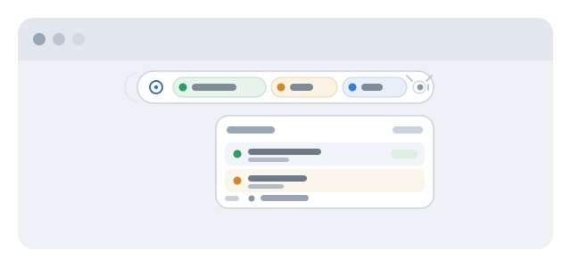

# dsh-session-beacon

English | [简体中文](README.zh-CN.md)

A lightweight, **client-only** [DeepSeek Harness](https://github.com/deepseek-ai/deepseek-harness) plugin that keeps the state of every listed session visible from the conversation header.



## Highlights

- A single icon in the **title-adjacent Session header action seat**, immediately after the Session title.
- One color represents the **highest-priority state** among all listed sessions, so a busy list stays calm.
- Hovering the icon opens a **floating session bar below the header** with active Sessions and the idle-session count.
- The bar collapses about **three seconds after the pointer leaves** it; when the All sessions panel closes, the bar is also scheduled to close (unless the pointer is still over it).
- Click a badge to open that Session.
- Click the icon, or the beacon button inside the bar, to open the **All sessions** panel with every listed Session, its status, and last-update time.
- Follows the active DSH theme tokens and ships with **English and Simplified Chinese** UI dictionaries.
- The Host half is an intentional empty `apply()`: the plugin cannot change agent behavior.

## Status priority

The icon shows one color for the highest-priority state. The badge bar shows one status dot per active Session.

| Priority | Color | Meaning | Source condition |
| --- | --- | --- | --- |
| 1 | Amber | Needs human confirmation | Pending approval, answer, or plan review |
| 2 | Green | Just completed, not opened yet | `completionUnread` |
| 3 | Blue | Running | Session running |
| 4 | Gray | Idle only | No active Sessions |

A running icon also carries a soft blue pulsing halo. The icon never displays a numeric count; the count is available through the tooltip, the hover bar, and the All sessions panel.

## Interaction

- **Hover the icon**: the floating bar appears directly below the header, aligned with the icon. It lists active Sessions as colored dot + title badges, plus an idle count chip. The bar closes about three seconds after the pointer leaves the icon and bar. It stays open while the pointer is over it or while the All sessions panel is open.
- **Click a badge in the bar**: opens that Session and closes the bar.
- **Click the icon or the beacon button in the bar**: opens the All sessions panel. Click a row to open its Session; click outside or press Escape to close.
- **Hover the icon while the panel is open**: the panel stays open and the floating bar remains available above it, so you can still switch Sessions from either surface.

The icon is a real header layout occupant, not a fixed overlay, so it does not cover the Session title or the window controls. The floating bar and panel are short-lived portals rendered in `shell.overlay`; they only appear during hover or after an explicit click.

## Installation

### Plugin Manager

1. Open **Plugins** in DSH.
2. Choose **Add plugin** and point it at this directory, or install the bundle from this repository.
3. Enable the `dsh-session-beacon` bundle. The plugin row is `session-beacon`.

### CLI

Clone the repository and link it into the profile you use:

```sh
git clone https://github.com/lcgash/dsh-session-beacon.git
dsh plugin --profile desktop add link:/absolute/path/to/dsh-session-beacon
```

Or install the GitHub package directly, if your DSH/pnpm version supports GitHub specs:

```sh
dsh plugin --profile desktop add github:lcgash/dsh-session-beacon
```

Replace `desktop` with your profile name (`web`, etc.) when needed. A page refresh or DSH restart may be required after replacing an already-installed bundle.

## Compatibility

- Built and verified against the DSH Web client in the `0.2.2-rc.5` desktop profile.
- Uses only the shipped client packages declared in `dsh.client.inject`: `dsh-client-ui-layout`, `dsh-client-ui-renderer`, and `dsh-client-ui-session`.
- Requires the `conversation.session.header.actions` list slot and the `shell.overlay` root list slot. The icon is registered in the title-adjacent Session action seat; the floating bar and panel use `shell.overlay`.
- A Session must be selected for the header action seat to exist; the icon therefore does not appear on pages without a Session.
- Only Sessions present in the Host's current list are shown. Archived or unlisted Sessions are not visible.

## Safety and boundaries

- Reads the existing Session list and Session status through Slot standard props (`useSessions`, `useSessionStatus`).
- Does **not** open Session history for preview. Only an explicit badge/row click opens a Session.
- Does **not** register a Host service, tool, event listener, model request, or persistence.
- Stores nothing: no `localStorage`, no session data, no network calls.
- The plugin’s only visible persistent UI is the 28px header action icon. Floating UI is transient and can be closed.

> The `+` / sidebar-collapse controls live in the frame's single, shipped `shell.leading` seat. Appending a third icon there would replace the shipped controls, so this plugin uses the title-adjacent Session action seat instead. This keeps the icon in the header layout without overlapping the window controls.

## Project layout

```text
.
├── index.js              # Host half: empty apply()
├── client.js             # Browser half: icon, floating bar, panel, localization
├── cordis.patch.yml      # Inserts the session-beacon plugin row
├── locale/
│   ├── en.json           # Plugin Manager metadata (English)
│   └── zh.json           # Plugin Manager metadata (简体中文)
├── docs/
│   ├── DETAIL.md         # English detail image
│   ├── DETAIL.zh.md      # Chinese detail image
│   └── preview.svg       # Feature illustration
├── icon.svg              # Plugin Manager icon
└── README.md / README.zh-CN.md
```

## Development

The browser half is a plain JavaScript client module; no build step is required.

```sh
npm run check
npm pack --dry-run
```

`client.js` embeds the UI dictionaries for English and Simplified Chinese; the files in `locale/` provide the Plugin Manager titles, descriptions, and detail documents.

## License

MIT © 2026 lcgash
