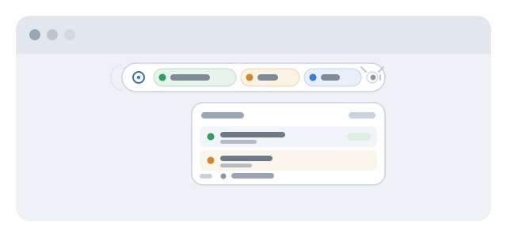

# dsh-session-beacon

[English](README.md) | 简体中文

一个轻量、**纯客户端**的 [DeepSeek Harness](https://github.com/deepseek-ai/deepseek-harness) 插件，让会话标题栏随时显示所有已列出会话的状态。



## 功能

- 在**会话标题右侧的标题操作槽位**显示一个 28px 状态图标，与标题栏其他控件同层。
- 图标只用一个颜色表示所有已列出会话中的**最高优先级状态**，会话再多也不会变成一排彩色噪声。
- 鼠标悬停图标时，在标题栏下方浮出**会话长条**，列出活跃会话和空闲会话数量。
- 鼠标离开图标与长条约 **3 秒**后自动收回；「所有会话」面板关闭后也会安排收回（指针仍在长条上时不会收回）。
- 点击长条上的徽章直接打开对应会话。
- 点击图标，或长条左侧的信号灯按钮，打开「所有会话」面板：列出全部会话、状态和最近更新时间，点击行打开会话。
- 跟随当前 DSH 主题 token，内置**英文和简体中文**界面词典。
- Host 半边是刻意留空的 `apply()`；插件不会改变 Agent 行为。

## 状态优先级

图标只显示一个颜色，取所有会话中的最高优先级。长条里的每个活跃会话各有一个状态点。

| 优先级 | 颜色 | 含义 | 触发条件 |
| --- | --- | --- | --- |
| 1 | 黄色 | 需要人工确认 | 等待审批、等待回答或计划待审 |
| 2 | 绿色 | 刚完成、还未查看 | `completionUnread` |
| 3 | 蓝色 | 运行中 | 会话正在运行 |
| 4 | 灰色 | 只有空闲会话 | 没有活跃会话 |

蓝色运行中状态额外带一个柔和的蓝色光圈脉冲。图标不显示数字；数量信息在 tooltip、悬停长条和「所有会话」面板里。

## 交互

- **悬停图标**：长条直接出现在标题栏下方、与图标左对齐。长条里是「状态点 + 会话标题」的徽章，以及空闲计数；指针离开图标和长条约 3 秒后收回。指针在长条上、或面板打开时保持。
- **点击长条里的徽章**：打开该会话，并收起长条。
- **点击图标，或长条里的信号灯按钮**：打开「所有会话」面板。点击行打开会话；点击外部或按 Esc 关闭。
- **面板打开时悬停图标**：面板保持打开，长条仍在面板上方，可从任一区域切换会话。

图标是标题栏的真实布局元素，不是固定覆盖层，因此不会遮挡会话标题或窗口控件。长条和面板是 `shell.overlay` 中的短时浮层，只在悬停或明确点击后出现。

## 安装

### 插件管理器

1. 打开 DSH 的 **插件（Plugins）**。
2. 选择 **添加插件（Add plugin）**，指向本目录，或从本仓库安装 bundle。
3. 启用 `dsh-session-beacon` bundle。插件行为 `session-beacon`。

### 命令行

克隆后链接到当前 profile：

```sh
git clone https://github.com/lcgash/dsh-session-beacon.git
dsh plugin --profile desktop add link:/absolute/path/to/dsh-session-beacon
```

如果你的 DSH/pnpm 版本支持 GitHub 规格，也可以直接安装：

```sh
dsh plugin --profile desktop add github:lcgash/dsh-session-beacon
```

按需把 `desktop` 换成自己的 profile 名（`web` 等）。如果替换的是已经安装的 bundle，可能需要刷新页面或重启 DSH。

## 兼容性

- 基于 DSH Web 客户端 `0.2.2-rc.5` 桌面 profile 开发与验证。
- 只依赖 `dsh.client.inject` 中声明的发行包：`dsh-client-ui-layout`、`dsh-client-ui-renderer`、`dsh-client-ui-session`。
- 需要 `conversation.session.header.actions` 列表槽和 `shell.overlay` 根列表槽。图标注册在标题操作槽；长条和面板使用 `shell.overlay`。
- 必须选中一个会话，标题操作槽才会存在；因此没有会话的页面上不会显示图标。
- 只显示 Host 当前列表中的会话；已归档或未列出的会话不可见。

## 安全与边界

- 只通过 Slot 标准 props（`useSessions`、`useSessionStatus`）读取现有会话列表与状态。
- **不会**为了预览去打开会话历史；只有明确点击徽章/行才会打开会话。
- 不注册 Host 服务、工具、事件监听、模型请求，也不做任何持久化。
- 不存储任何内容：没有 `localStorage`、没有会话数据、没有网络请求。
- 常驻可见 UI 只有标题栏里的 28px 图标；长条与面板都是短时浮层，可以关闭。

> `+` / 侧边栏收缩按钮位于框架级、被官方占用的 single `shell.leading` 槽位。往那里追加第三个图标会替换官方控件，因此本插件使用标题右侧的会话操作槽位；这样仍在标题栏布局内，又不会覆盖窗口按钮。

## 项目结构

```text
.
├── index.js              # Host 半边：空 apply()
├── client.js             # 浏览器半边：图标、浮层长条、面板、双语
├── cordis.patch.yml      # 插入 session-beacon 插件行
├── locale/
│   ├── en.json           # 插件管理器元数据（英文）
│   └── zh.json           # 插件管理器元数据（简体中文）
├── docs/
│   ├── DETAIL.md         # 英文详情图
│   ├── DETAIL.zh.md      # 中文详情图
│   └── preview.svg       # 功能示意图
├── icon.svg              # 插件管理器图标
└── README.md / README.zh-CN.md
```

## 开发

浏览器半边是普通 JavaScript 客户端模块，无需构建：

```sh
npm run check
npm pack --dry-run
```

`client.js` 内嵌英文与简体中文界面词典；`locale/` 下的文件提供插件管理器标题、描述和详情文档。

## 许可证

MIT © 2026 lcgash
